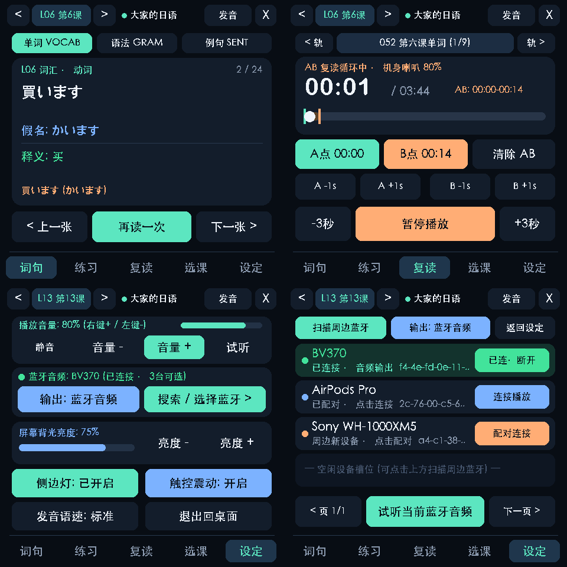
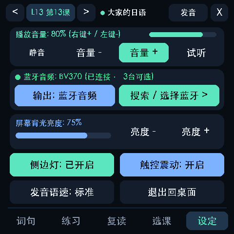
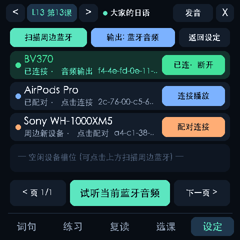

# 大家的日语 · ESP32 随身学习终端 & 喜马拉雅 AB 段复读机 (`v1.3.0`)

本项目将 **ESP-Mosaico (ESP32-S31, 480×480 触控屏 + 内置喇叭 + 侧边双机械按键 + 6 颗 RGB 灯)** 与 Mac mini 本地日语导学 Agent（`minna-no-nihongo-agent`）深度打通，并集成喜马拉雅 **《大家的日语初级1(第二版听力练习)》** 全套 238 条离线音轨，在 ESP32 上打造了一体化的 **5 页签随身日语学习终端与硬件级 AB 段复读机**。



---

## 一、核心功能一览 (`v1.3.0`)

### 1. 五大页签一体化设计（480×480 触控 + 物理双侧键）
- **页签 1 · `词句`（闪卡记忆）**：
  - 覆盖第 1～25 课全套 **单词 (`VOCAB`) / 语法 (`GRAM`) / 例句 (`SENT`)**，支持毫秒级分类切换、翻面查看中文释义与假名标注，点击或按右侧键 `KEY1` 即可朗读日语标准发音。
- **页签 2 · `练习`（四模式互动刷题 + GNN 学情联动）**：
  - 支持 **填空 (`fill_blank`) / 改错 (`correction`) / 中译日 (`translate_zh_to_ja`) / 错题本 (`review`)** 四种题型。
  - 触屏作答后立即判定对错并展示语法解析，侧边 RGB 灯条同步闪烁翠绿（正确）或珊瑚红（错误），作答记录实时同步回写至 `minna-no-nihongo-agent` 学情库（`interaction_log.jsonl`、`mastery.json`、`error_log.csv`、`review_queue.json`）。
- **页签 3 · `复读`（喜马拉雅 238 轨离线听力 + 硬件级 AB 段复读机）**：
  - 完整收录喜马拉雅专辑 `67798305`《大家的日语初级1(第二版听力练习)》全部 **238 条音轨**（涵盖五十音及第 1～25 课单词、文型、例文、会话、练习 A/B/C、问题）。
  - 支持触屏或**右侧机械按键 `KEY1` 盲操打点**：按第 1 下标起点 A → 按第 2 下标终点 B 并立即进入 `[A, B]` 循环复读 → 按第 3 下清除 AB；支持 `A ±1s` / `B ±1s` 秒级微调与 `±3秒` 快进快退。
- **页签 4 · `选课`（25 课全量离线包毫秒级切换 + GNN 导学看板）**：
  - ESP32 本地闪存内置 `app/lessons/L01.json` ～ `L25.json` 全部 25 课独立数据包，点选任意课次即可**零延迟同步更新**前 3 个页签的词汇、语法、例句、4 类练习题与喜马拉雅对应课次音轨。
- **页签 5 · `设定`（音量/亮度/外设控制 + 周边蓝牙音频扫描与配对）**：
  - **音量调节（0%–100%）**：支持触控 `[静音]`、`[音量 -]`、`[音量 +]`、`[试听]`，以及在 `设定` 页签下直接按 **右侧键 `KEY1`（音量 +10%）** / **左侧键 `KEY2`（音量 -10%）**。
  - **周边蓝牙音频搜索、配对与多设备选择（`搜索 / 选择蓝牙 >`）**：
    - 支持实时扫描周边处于可发现状态的蓝牙音箱与蓝牙耳机（如 `BV370`、`AirPods Pro`、`Sony` 等），一键发起配对连接，并在 **蓝牙音频无线立体声播放** 与 **ESP32 机身喇叭外放** 之间自由切换。
  - **硬件偏好持久化**：屏幕背光亮度（10%–100%）、侧边 RGB 灯开关、触控震动开关、TTS 标准/慢速朗读切换均自动保存至 `/apps/minna_nihongo/preferences.json`。

| 第5页签：系统设定主页 | 蓝牙音频扫描、配对与选择面板 |
| :---: | :---: |
|  |  |

---

## 二、目录结构

```text
.
├── app/                        # ESP32 端 Lua 应用包 (/apps/minna_nihongo)
│   ├── assets/                 # DFN1 定制中日文字库 (cjk-16/20/26.dfn, 2580 字形)
│   ├── lessons/                # 第 1~25 课全量离线数据包 (L01.json ~ L25.json)
│   └── scripts/                # Lua 状态机 (model.lua)、渲染器 (render.lua)、主循环 (main.lua)
├── host/                       # Mac mini 端桥接服务与音频/蓝牙引擎
│   ├── bridge.py               # 实时同步守护进程 + Web 伴侣复读控制台 (http://127.0.0.1:7865)
│   ├── audio_engine.py         # FFmpeg AB 切片、Kyoko 日语 TTS、蓝牙扫描/配对与零延迟流式播放
│   ├── dataset.py              # 与 minna-no-nihongo-agent 教材库及 GNN 学情双向同步
│   ├── device.py               # ESP32 局域网发现、增量上传与生命周期控制
│   └── service.py              # macOS LaunchAgent 开机自启管理
├── scripts/
│   ├── bt_helper.swift         # macOS IOBluetooth + CoreAudio 原生蓝牙扫描/配对/音频路由工具
│   ├── build_fonts.py          # DFN1 字库自动构建工具
│   └── download_ximalaya.py    # 喜马拉雅 238 轨全套音频下载与分类归档脚本
├── audio/minna_no_nihongo_1/
│   └── manifest.json           # 238 条音轨完整索引与时长元数据
└── tests/
    ├── check.py                # Lupa (Lua 5.4) 全页签交互与像素级渲染自检
    └── preview.py              # 480x480 离线屏幕仿真器
```

---

## 三、快速开始

1. **准备配置与音频**
   ```bash
   cp bridge.example.json bridge.local.json
   # 如需重新拉取喜马拉雅 238 条离线 MP3 音频：
   python3 scripts/download_ximalaya.py
   # 编译 macOS 原生蓝牙扫描与配对助手：
   mkdir -p .runtime && swiftc scripts/bt_helper.swift -o .runtime/bt_helper
   ```

2. **上传并启动 ESP32 端应用 + Mac mini 后台守护服务**
   ```bash
   python3 host/device.py upload
   python3 host/device.py bootstrap
   python3 host/device.py start
   python3 host/service.py install
   ```

3. **桌面快捷指令**
   - 双击 **`启动大家的日语ESP32.command`**：唤醒 ESP32 学习端并打开网页复读控制台（`http://127.0.0.1:7865`）。
   - 双击 **`切回AI状态牌.command`**：随时切回 `AI Mac mini` 状态牌应用（双应用共存，互不覆盖）。

## 2026-10-18 与 AI Mac mini 共存修复

后台现在只同步数据、检查待部署差异、在无其他前台且有空闲槽位时恢复接收器；不会自动热覆盖脚本或抢开日语界面。部署使用 `python3 host/device.py deploy`，打开日语界面使用 `python3 host/device.py ensure-start` 或网页的显式激活按钮；切回状态牌使用 `切回AI状态牌.command`。失败会报告可恢复状态，不再一律声称成功。

Mini 与日语 Mac 服务都应保留运行，不能停用 Mini/Kimi 的 LaunchAgent 处理设备槽位。状态牌已把灯光并入 UI，正常两个接收器加当前 UI 共三槽。两边启动均清理旧队列，并保留初始化期间新收到的退出请求。接收器状态不会继续显示已退出 UI 的旧在线记录。详见 AGENTS.md。

Codex 已统一部署、逐文件校验：Mini 70项检查与日语16项共存回归通过；真机连续两轮日语/状态牌往返在线，日语后台重启和接收器重载不抢占 Mini UI。Air 原文件和配对保持不变。本次没有重启或刷写设备，也没有推送 GitHub。验收细节在 Codex 项目的 Mac mini使用说明.md 及本地 evidence/coexistence-20261018/。

## 2026-10-23 朗读串播修复与真机验收

词句、语法和答题朗读现在使用独立的 `tts` 指令：点击朗读立即停止课文时间线，清除课文续播及 A-B 循环状态。Mac 同时清除上一条课文播放请求，避免后续调音量或切换输出时恢复旧课文。ESP32 喇叭收到朗读片段仅播放一次；蓝牙由 Mac 播放。

本次现场设备地址由 `192.168.31.124` 变为 `192.168.31.125`，但无法据此断定具体是哪次重启引起。现有发现模块按配对 MAC 验证设备并更新本机地址，不依赖固定 IP；两者须处于可互访的局域网。路由器为该设备保留 DHCP 地址可以进一步减少地址变化。

同时发现四个 Lua 槽位被占满，日语接收器缺失。此次统一交接临时释放了已核实的 Air 灯光任务槽位，保留 Air 接收器、文件及配对，恢复日语接收器和界面。Mini、日语的 Mac 后台服务继续运行。日常请先退出当前界面，再显式切换目标应用；后台不会为了恢复日语而强停其他应用，因此无空槽时可能进入等待状态。不要通过停用 Mini/Kimi 服务释放设备槽位。

已重新连接 BV370，用户真机确认“有声音，读完没有串播”；设备返回日语界面在线且 `playing=false`，Mini 接收器仍同步。TTS Lua 回归（蓝牙/ESP32 两目标）、16 项共存回归、五页及蓝牙弹窗检查通过。ESP32 自带喇叭本次未做人工听音验收。没有刷机或重启硬件。蓝牙断开后仍可能需要在设定页重新连接，不能将本次验收理解为断电重启后的自动重连保证。

补充回归：使用已安装 Lupa、Pillow 的 Python 环境执行 `python tests/tts_check.py`、`python tests/coexistence_check.py`、`python tests/check.py`。本地令牌、日志和现场证据不随本次修复提交。
